# Архитектура и границы доверия

## Два уровня решений

Наблюдаемая модель разделяет общий CI/CD policy и конкретный native release contract. Первый слой, Studio CI, планирует область проверок по diff. Второй слой вычисляет component fingerprints, выбирает built/reused и формирует доказательства выпуска. Ни один из них сам по себе не даёт production authority.

Studio CI не builder и не deployer. Сборка выполняется отдельными checked recipes; активация — независимым target gate после сверки candidate, original evidence, live state и release semantics.

```mermaid
flowchart LR
    author["Автор изменения"] --> git["Приватный Git и protected ref"]
    git --> admission["Admission вне checkout"]
    admission --> runner["Доверенный self-hosted runner"]
    subgraph ci["Контур CI без production credentials"]
        runner --> planner["Первый слой: scope planner"]
        planner --> contract["Второй слой: component release contract"]
        contract --> build["Build и acceptance изменённых компонентов"]
        build --> checkpoint["Checked checkpoint до публикации"]
        checkpoint --> publisher["Отдельный publication step"]
        runner --> tests["Только disposable test data"]
    end
    publisher -->|"Scoped registry write"| registry["Закрытый OCI registry"]
    registry -->|"Read-only pull"| gate["Независимый promotion gate"]
    operator["Operator-owned policy вне checkout"] --> gate
    gate --> target["Preview или production"]
    target --> runtimeSecrets["Secrets остаются на площадке"]
    gate --> acceptance["Runtime и business-safe acceptance"]
```

## Границы участников

| Участник | Чему можно доверять | Что обязательно проверять независимо |
|---|---|---|
| Git и protected ref | Immutable candidate SHA и review history | Actor/event/ref, отсутствие второго release writer |
| Admission | Operator-installed rules и runner binding | Что выполняется именно ожидаемый workflow на назначенном runner |
| Scope planner | Детерминированный plan по policy и diff | Полный baseline, unknown inputs, policy identity |
| Component contract | Fingerprints полного дерева, recipes и tool identities | Пересчёт на target, original built receipt, tested bytes |
| CI build | Checked output и checkpoint конкретного run/attempt | Все required checks, отсутствие production credentials |
| Publisher | Запись только в разрешённый namespace | Immutable digest, tag conflicts, свежий scan |
| Registry | Content-addressed bytes | Соответствие index/platform/config/layers и целевой архитектуре |
| Target gate | Operator policy и accepted baseline | Current protected ref, authorization, original run, runtime state |
| Runtime | Площадочные secrets и canonical data | Live identities, roles, scenarios, backup и rollback |

Доверие не наследуется по соседству в одном workflow. Зелёный planner не подтверждает build; зелёный build не подтверждает публикацию; наличие image не подтверждает live acceptance.

## Credentials как отдельные возможности

Build получает только disposable test credentials. Publisher существует на preflight/publication steps и не нужен во время fixtures. Target использует read-only API/registry. Production secrets остаются на площадке и не передаются через CI variables, artifact или checkout.

Разделение credentials проверяется deny-сценариями: build не читает production secret, target не публикует image, publisher не активирует release, candidate artifact не меняет operator policy. Список названий переменных без таких проверок не доказывает границу.

## Путь release

1. **Candidate.** Полный SHA и правильный baseline связываются с разрешённым event/ref.
2. **Scope.** Первый слой выбирает always-on, isolated и native checks. Неизвестное расширяет область.
3. **Components.** Второй слой сравнивает fingerprints с accepted baseline. Для reused требуется исходный built checkpoint.
4. **Build и acceptance.** Изменённые компоненты собираются один раз. Проверяются те bytes, которые будут опубликованы.
5. **Checkpoint.** До registry publication сохраняется manifest с run/attempt, test receipts и component identities.
6. **Publication и scans.** Publisher записывает artifacts; все выпускаемые digests получают свежие raw scans.
7. **Independent promotion.** Gate заново проверяет source provenance, OCI chain, policy и текущий accepted state.
8. **Selective activation.** Меняются только компоненты с новыми image IDs; остальные identities сохраняются.
9. **Live acceptance.** Проверяются роли, сценарии, данные и external behavior. Только после этого release считается принятым.

## Push/dispatch вместо универсального PR/preview

Наблюдаемый workflow имеет триггеры `push` и `workflow_dispatch`. Dispatch сверяет ожидаемый SHA, purpose и reconciliation metadata. Resume допускается только на том же protected main SHA и ссылается на исходный authorization run.

Эта модель не обещает единого PR environment, автоматического preview для любого fork или universal native-release mapping. Такие возможности требуют отдельной threat model, preview ACL, data isolation, lifecycle и acceptance design.

## Отдельные content releases

Read-only documentation/catalog/inventory snapshot получает собственный content SHA. Принятый application image и его component source SHA сохраняются. Проверяются checked content, projections и readback, без повторной компиляции ради Markdown.

Content path не снижает требования к native release: executable content, control docs или build inputs переводят изменение в другой scope. Источник identity и content identity не смешиваются в одно поле.
