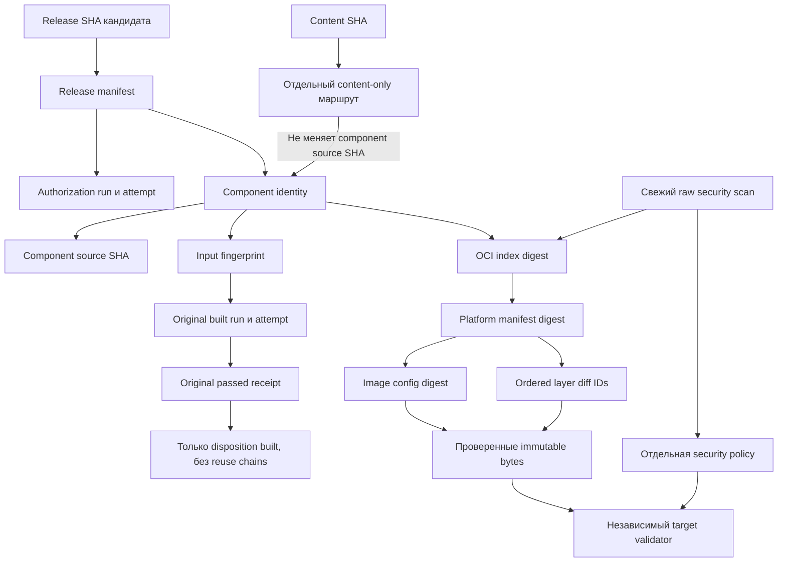
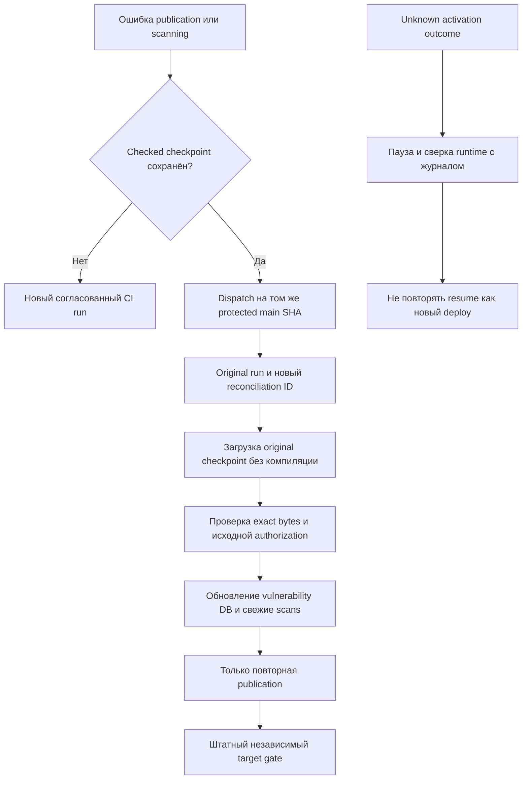

# Native component release и идентичность

## Статус модели

Документ описывает наблюдаемый component release v2: пять независимых images, отдельные source identities и исходные build receipts. Это историческая модель реализации, а не действующий публичный API и не утверждение о текущем production.

Release SHA кандидата не равен source SHA каждого компонента. После узкого изменения один component может иметь текущий release SHA, а четыре reused components сохраняют свои исходные source SHA. Content SHA описывает отдельный snapshot и не подменяет ни одно из этих значений.

## Release identity graph

Синтетический [`release-manifest.json`](../examples/release-manifest.json) показывает те же связи с недействительными identities. Он имеет `status: "synthetic-only"`, `release_authorized: false` и устаревшую учебную дату scan, поэтому не может служить доказательством.

## Три source identities

| Идентичность | Что обозначает | Типичная ошибка |
|---|---|---|
| Release SHA | Полный Git candidate, разрешённый к продвижению | Требовать этот SHA в label каждого reused image |
| Component source SHA | Git source исходной built попытки компонента | Считать последний main SHA источником всех components |
| Content SHA | Checked read-only content snapshot | Подменять им application source или объявлять rebuild |

Worker policy, backup и rollback читают source конкретного компонента. Неизменённые сервисы не пересоздаются ради визуального совпадения labels.

## Original run и original attempt

У каждого component сохраняются исходные `run_id`, `attempt`, `artifact_id` и hash receipt. Наблюдаемый контракт принимает исходную build attempt `1`: повторная попытка того же workflow не переписывает происхождение уже проверенных bytes.

Для `built` component source SHA совпадает с release SHA текущего build candidate, а run совпадает с исходным build run. Для `reused` эти поля указывают на исходный built run. Target загружает original artifact по доверенному API, проверяет его hash и сравнивает repository, source, run, attempt, index/config identity и user.

Цепочка `reused → reused → built` запрещена. Допускается плоская ссылка `reused → original built`. Такой подход исключает рекурсивные циклы и копирование чужого зелёного результата без полного provenance.

## OCI identity

Верхний OCI index digest связывает кандидата с multiarch объектом, но сам по себе недостаточен. Gate проверяет:

1. repository и index digest;
2. platform manifest для целевой архитектуры;
3. image config digest;
4. ordered rootfs diff IDs;
5. tested bytes и receipt именно этой цепочки.

Mutable tag не заменяет digest. Конфликт существующего тега останавливает publication/resume, а не перезаписывает чужой artifact.

## Security scan как отдельное доказательство

Свежий raw scan выполняется для каждого выпускаемого digest, включая reused. База уязвимостей обновляется перед прогоном; отчёт связывается с точным repository/digest, архитектурой, config и layers. Пустой, malformed, устаревший или относящийся к другому subject отчёт отклоняется.

Общая policy блокирует HIGH/CRITICAL с доступным исправлением. Остальные findings остаются в отчёте. Нулевой blocking count не означает «ноль уязвимостей» и не оценивает риск unfixed/LOW/MEDIUM.

Успешный exit code scanner не заменяет release gate: отдельный evaluator применяет policy, а target проверяет freshness и identity. Сканирование при выпуске не создаёт расписание мониторинга CVE уже работающих образов.

## Publication-only resume

Resume применяется, когда checked build и checkpoint сохранены, но завершилась ошибкой публикация или scanning. Он повторяет только publication path и не собирает release images заново.

Dispatch требует ожидаемый полный SHA, purpose `resume`, original run и новый reconciliation ID. Первый слой может вычислить full metadata scope, но native Build step пропускается. Вспомогательные policy checks сохраняются.

Resume не даёт нового release authority. Он остаётся привязанным к исходному protected main push, run и candidate. Если проверенного image больше нет на CI, старый receipt не разрешает молча пересобрать «такой же» образ: сначала восстанавливают и сверяют точные bytes либо запускают новый согласованный CI cycle.

После начала активации unknown outcome не обрабатывается publication resume. Сначала читают runtime и исходный attempt, сохраняют историю и выполняют ручную сверку.

## Сохранение evidence

Checkpoint до публикации, original build receipts, raw scans и target acceptance — разные доказательства. Их сроки хранения согласуются с окном rollback. Короткоживущий CI artifact нельзя считать единственным долгосрочным хранилищем release provenance.

В публичном playbook нет настоящих receipts, IDs и координат. Примеры демонстрируют форму рассуждения, но не переносят частную схему и не доказывают выпуск.
