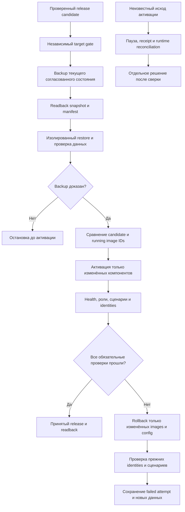

# Эксплуатация, приёмка и восстановление

## Что считается выпуском

Push, зелёный CI и опубликованный digest — этапы кандидата. Release принят только после независимого target gate, selective activation и live acceptance нужных ролей и сценариев. Точное состояние всегда читается из свежих runtime facts и принятого release record, а не из этого исторического playbook.

## Общий контур

## До активации

1. Сверить candidate release SHA, authorization run/attempt, component sources и original receipts.
2. Проверить operator-installed policy, свежие scans и цепочку OCI index/platform/config/layers.
3. Сериализовать выпуск lock/lease и сравнить accepted state через compare-and-swap. Устаревший run не переключает площадку.
4. Сохранить previous images/config и фактически запущенные identities всех компонентов.
5. Проверить ресурсы, writable paths, permissions, network aliases и отсутствие второго writer.
6. Получить доказанный backup: snapshot, readback и изолированный restore. Наличия timer или файла недостаточно.
7. Зафиксировать recovery point до первого возможного business effect.

Candidate smoke не должен запускать второй scheduler/writer. Read-only health и проверки с business effects различаются заранее.

## Backup, readback и restore

Backup успешен только тогда, когда подтверждены целостность snapshot, чтение manifest/bytes и восстановление в изолированном контуре. Restore проверяет не просто возврат команды без ошибки, а ожидаемые schema, rows, права и application read scenario.

Несколько баз или snapshots могут быть индивидуально согласованы, но это не доказывает межбазовую атомарность. Кратковременная остановка процесса для cold copy не равна непрерывному uptime. Кеши и производные indexes не подменяют canonical data.

Restore drill не гарантирует любой будущий restore. Новая схема, credentials, объём, зависимости и время после новых записей требуют собственной оценки. Не инициализируйте backup repository повторно после network/auth failure и не меняйте retention ради текущего выпуска.

## Selective activation

Target сравнивает candidate image IDs с фактически running IDs. Перезапускаются только различающиеся компоненты. Остальные контейнеры, canonical data и worker controls сохраняются.

После активации сверяются все пять identities, а не только изменённый service. Для узкого PDF release это означает новый PDF identity и сохранённые runtime, worker, MCP, memory и data identities. Для content-only меняется checked content snapshot при неизменном application image.

## Acceptance

| Область | Минимальное доказательство |
|---|---|
| Identity | Exact runtime image/config/source каждого компонента и отсутствие drift |
| Readiness | Ожидаемый structured readiness, не любой HTTP 200 |
| Роли и ACL | Owner/consumer access и отрицательные проверки без раскрытия credentials |
| Сценарии | Критический UI/API/render/worker path с синтетическими безопасными данными |
| Сохранность | Unchanged services, data identities и отсутствие второго writer |
| Recovery | Previous images/config, rollback receipt и after-writes ограничения |
| Внешний контур | TLS/redirects и реальный публичный сценарий, если применимо |

Health одного сервиса не заменяет сценарий. HTTP 200 с `ready: false` не является готовностью. Реальные клиентские заявки и финансовые записи для smoke не создаются.

## Отказ и кодовый rollback

При failed activation сохраняют failed attempt, diagnostics и текущее состояние. Rollback возвращает previous images/config только изменённых компонентов после сверки writer/lease. Затем повторяются readiness, критический сценарий и проверка незатронутых identities.

Откат образа не откатывает базу данных. После новых business writes старый dump поверх canonical writer не восстанавливается. Несовместимая миграция требует отдельного recovery plan с явной оценкой потери данных и остановки writers.

Уже принятый тот же release — проверенный no-op, а не повторный restart. Дрейф конфигурации нельзя скрыть таким no-op.

## Unknown outcome

Таймаут клиента не доказывает ни успех, ни откат. Сначала читают исходный request/receipt, runtime identities, lock и журнал. Повторяют только операцию с доказанной идемпотентностью и тем же identity согласно runbook; новый request ID не создаёт второй эффект.

Не удаляйте spool/receipt, не перезапускайте миграцию вслепую и не повторяйте publication-only resume после неизвестной активации. Неизвестное состояние остаётся `unknown`, пока независимая сверка не дала результата.

## Отдельный content-only маршрут

Content release проверяет content SHA, repository/application selection, snapshot projections и readback. Принятый application image, source SHA и credentials сохраняются. Runtime, worker и memory не пересоздаются ради read-only Markdown.

Если изменение влияет на executable code, build inputs или control policy, content-only маршрут неприменим. Это отдельный release path, а не способ обойти полный native gate.
