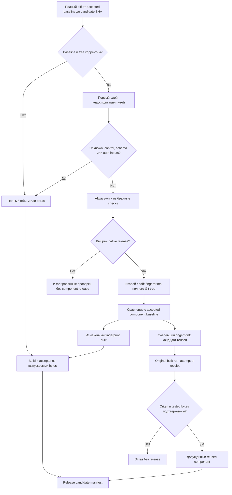

# Два слоя выбора области и компонентов

## Зачем нужны два слоя

Первый слой отвечает на вопрос «какие проверки запустить для этого diff?». Второй — «какие release components изменились и какие доказательства нужны для их повторного использования?». Объединять эти решения нельзя: запуск native checks ещё не означает сборку всех образов, а reuse образа ещё не означает пропуск связанных acceptance cases.

Оба слоя работают fail-closed. Отсутствующий baseline, неполный tree, неизвестный путь, symlink/mode change, control/schema/auth change или противоречие в receipt не сокращают проверку.

## Первый слой: scope plan

Синтетический [`studio-ci.json`](../examples/studio-ci.json) показывает четыре категории конфигурации:

- `components` связывает path globs с логическими областями;
- `checks` задаёт always-on и выборочные команды;
- `passive_docs` перечисляет пассивные документы, которые не являются build inputs;
- `full_scope` заставляет расширить проверку при изменении критических входов.

Diff строится от корректного accepted baseline до полного candidate SHA, а не только между двумя последними commits. Rename, delete, executable bit, symlink и submodule нельзя отбрасывать. При недоступном base планировщик выбирает full либо останавливается согласно policy.

План содержит выбранные components, proposed/skipped checks, policy identity и причины решения. Required check для docs-only может завершиться успешно с `application_release: false`, но это не release и не повод ожидать новый image.

Изменение самой planner policy — control change. Оно не классифицируется как passive документация.

## Второй слой: component fingerprints

Синтетический [`release-policy.json`](../examples/release-policy.json) задаёт входы каждого компонента. Fingerprint вычисляется не по одному имени каталога, а по канонической совокупности:

1. путь каждого выбранного файла;
2. Git mode и blob SHA;
3. build recipe и его версия;
4. immutable IDs подготовленных toolchain images;
5. версия схемы fingerprint и имя компонента.

Полный Git tree нормализуется и сортируется. Дубликаты путей, пустой набор входов, неподдерживаемый mode или специальный build input отклоняются. Удаления и mode changes влияют на сравнение.

Совпадение fingerprint позволяет предложить `reused`. Это ещё не допуск: target проверяет, что original source/run/attempt принадлежит успешной **built** попытке, hash исходного receipt совпадает, а tested bytes равны публикуемым. Reuse другого reused компонента не создаёт рекурсивную цепочку.

## Четыре независимых решения

| Решение | Вход | Результат |
|---|---|---|
| Build scope | Component fingerprints и baseline | `built` или кандидат `reused` |
| Test scope | Изменённые inputs, dependency closure, control risk | `full`, `knowledge` или `components` в наблюдаемой модели |
| Artifact reuse | Original built receipt, source/run/attempt, tested bytes | Допуск либо отказ reuse |
| Deploy scope | Разница candidate и running image IDs | Только изменённые сервисы |

Пример развилки: изменился только PDF input. Первый слой выбирает native release, второй строит PDF и переиспользует четыре остальных образа, но security scans нужны всем пяти. На площадке перезапускается только PDF; acceptance проверяет и сохранность остальных identities.

Другой пример: изменился memory test fixture без смены image inputs. Memory image может быть reused, но реальные SDK/consumer acceptance cases всё равно обязательны. Reuse не отменяет tests.

## Пять компонентов и их особенности

| Компонент | Наблюдаемая граница | Что расширяет acceptance |
|---|---|---|
| `runtime` | Application source, contracts, recipe, runtime SQL inputs | Любое изменение общего runtime/worker набора вызывает full suite |
| `worker` | Тот же общий source set, но отдельный image и runtime controls | Actor, scheduler, epoch, schema и writer safety |
| `mcp` | Backend source, infra inputs, locked dependencies, recipe | Protocol consumers, auth, domain commands и real dependencies |
| `memory` | Memory-specific source/infra и locked toolchain | Canonical read/write, crash/ACK recovery, index и data compatibility |
| `pdf` | Frozen package/browser graph и renderer checks | Реальный render, refusal cases, bounded readiness и startup recovery |

Общий runtime/worker input set — особенность наблюдаемой реализации, не универсальное правило. Другой проект может иметь один component, другой состав или независимые workers.

## Suite selection

Если baseline недоступен либо изменились `runtime`/`worker`, наблюдаемая модель требует `full`. Control, schema, auth, неизвестные и неподдерживаемые изменения также сохраняют полный gate.

Для узких `mcp`/`memory` изменений допустим focused `knowledge` suite только при точном проверенном backend image и свежей синтетической БД. Холодный CI без этой identity возвращается к full. Изолированный focused путь не заменяет реальные HTTP consumers, SQL readback, потерю COMMIT ACK, process crash и требуемые внешние зависимости.

Эти названия suite относятся к наблюдаемому контракту. Публичная схема не объявляет их универсальным API.

## Passive docs и content-only

Пассивная документация не меняет application bytes и не запускает component release. Отдельный content-only snapshot, напротив, выпускается с content SHA, проверками и readback при неизменном application image.

Markdown может быть passive, release content или build input. Решение зависит от фактического потребления файла, а не от расширения `.md`.

## Ошибки, которые модель должна отклонять

- diff только последнего commit скрывает более раннее изменение;
- общий lockfile изменён, но выбрана узкая проверка;
- reused ссылается на другой reused receipt;
- component label приравнен к release SHA без учёта component source SHA;
- один зелёный job принят за весь release;
- неизменённые сервисы перезапущены для «выравнивания» labels;
- отсутствующий original artifact восполнен новой сборкой под старым receipt.
